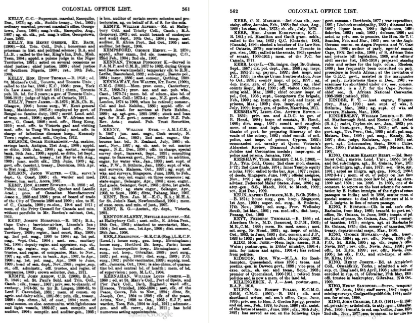

## Thousands of pages like this… {#printed-page}

{fig-alt="Two facing pages, 561 and 562, of the Colonial Office List for 1913: dense columns of abbreviated biographies from KELLY to KING" height="420" fig-align="center"}

[…became the moving atlas on the next slide.]{style="font-size:0.9em;color:#f3ead3"}\
[*The Colonial Office List for 1913* (52nd publication), pp. 561–562. Scan digitised by Google, from the Internet Archive.]{.caption}

::: notes
0–1. One simple point before the video: this pipeline turned thousands of printed pages like these into the animated atlas that follows. Two facing pages of the Record of Services hold about forty compressed biographies; the project OCR’d 85 volumes, 1867–1966 (Colonial Office Lists, with the 1935 Dominions Office List and the 1951–65 Commonwealth Relations Office Lists), plus the India Office List. The List was first published in 1862; the project’s run starts in 1867. Then play the video.
:::

## {#mobility-video .video-slide background-color="#15161a"}

```{=html}
<video data-autoplay controls muted playsinline preload="metadata"
       poster="images/combined-mobility-frame.jpg"
       aria-label="Animated atlas of imperial career postings">
  <source src="https://jimclifford.ca/col_matching/combined_mobility.mp4" type="video/mp4">
  <source src="media/combined-mobility.webm" type="video/webm">
  Your browser cannot play this video. Use the direct link below.
</video>
<p class="video-link"><a href="https://jimclifford.ca/col_matching/combined_mobility.mp4" target="_blank" rel="noopener">Open the video directly</a> · Earlier atlas export</p>
```

::: notes
0–1. Let the 56-second video run. It is an earlier export; the dated build counts in the deck supersede its caption. These are sequences of recorded postings, not observed travel routes. The video starts muted when this slide opens; use Play or Replay in its controls if needed. The direct link opens the MP4 separately. Use the downloaded copy if the network fails.
:::

## What one arc needs {.smaller}

> WODEHOUSE, SIR PHILIP E.—Entered the Ceylon civil service as a writer, May, 1828; … superintendent of Honduras, 1851; … governor of British Guiana; … in 1861 was appointed governor of the Cape of Good Hope.

| Printed wording | Event | Historical place | Plotting seat | Year |
|---|---|---|---|---|
| writer, May, 1828 | writer | British Ceylon | Colombo | 1828 |
| superintendent of Honduras | superintendent | British Honduras | Belize | 1851 |
| governor of British Guiana | governor | British Guiana | Georgetown | 1854 |
| governor of the Cape of Good Hope | governor | Cape Colony | Cape Town | 1861 |
| governor of Bombay (later editions; India Office List) | governor | Bombay Presidency | Bombay | 1872–77 |

```{=html}
<div class="flow">
  <div class="node"><b>Printed clause</b><span>“governor of the Cape of Good Hope”</span></div>
  <div class="arrow">→</div>
  <div class="node"><b>Event</b><span>governor · 1861</span></div>
  <div class="arrow">→</div>
  <div class="node blue"><b>Checked place identifier</b><span>Cape Colony, a Wikidata item</span></div>
  <div class="arrow">→</div>
  <div class="node blue"><b>Plotting seat</b><span>Cape Town: a proxy, not a residence</span></div>
  <div class="arrow">→</div>
  <div class="node"><b>Arc</b><span>British Guiana → Cape</span></div>
</div>
```

::: notes
1–3. The quotation is the 1867 Colonial Office List entry, which predates Bombay; the Bombay row is printed in later Colonial Office editions (1878) and in the India Office List. The full table, identifiers and trace are on step 1. “Honduras” to “British Honduras” is an interpretation, kept separately from printed wording. A capital is a plotting proxy, not evidence of residence. Wodehouse is a checked example of the cross-service match; the other bridges need review.
:::


## Two Lists, one career, mapped {#one-clause-one-arc-motion-draft .motion}

```{=html}
<div style="display:flex;gap:1em;align-items:flex-start">
<div style="flex:0 0 47%">
  <div class="rawbio"><span class="src">Colonial Office List, 1878 · raw OCR</span>WODEHOUSE, SIR PHILIP E., G.C.S.I. (created, 1876), <span class="mk co" data-at="800">K.C.B. (Creat. 1862)</span>.—Entered the <span class="mk co" data-at="2600">Ceylon</span> civil service as a <span class="mk co" data-at="2600">writer, May, 1828</span>; promoted to be assistant colonial secretary and clerk of the executive and legislative councils, Oct., 1833; <span class="mk co" data-at="2600">district judge of Kandy, 1840</span>; government agent for the western province, 1843; was appointed <span class="mk co" data-at="3700">superintendent of Honduras, 1851</span>; <span class="mk co" data-at="5000">in Feb., 1854, governor of British Guiana</span>; was employed <span class="mk co" data-at="6200">in 1858 on a special mission to the government of Venezuela</span>; and <span class="mk co" data-at="7400">in 1861 was appointed governor of the Cape of Good Hope</span>, and also high commissioner in South Africa. <span class="mk co" data-at="8800">Governor of Bombay</span>, <span class="mk co diff" data-at="10300">7th May, 1872</span>, to 30th April, 1877.</div>
  <div class="rawbio io"><span class="src">India Office List, January 1889 · raw OCR</span>WODEHOUSE, SIR PHILIP EDMUND, K.C.B., G.C.S.I.—<span class="mk " data-at="2600">Writer, Ceylon civil service, May, 1828</span>; assistant colonial secretary, and clerk of the executive and legislative councils, Oct., 1833; <span class="mk " data-at="2600">district judge of Kandy, 1840</span>; government agent for the Western Province, 1843; <span class="mk " data-at="3700">superintendent of Honduras, 1851</span>; <span class="mk " data-at="5000">governor of British Guiana, 9th Feb., 1854</span>; <span class="mk " data-at="6200">employed on a special mission to Venezuela, Feb.-May, 1858</span>; C.B., May, 1860; <span class="mk " data-at="7400">governor and commander-in-chief of the Cape of Good Hope</span> and its dependencies, and Her Majesty's high commissioner for the settling of the affairs of the territories adjacent to the eastern frontier of that colony, <span class="mk " data-at="7400">29th Oct., 1861</span>; <span class="mk " data-at="800">K.C.B., July, 1862</span>; <span class="mk " data-at="8800">governor of Bombay</span>, <span class="mk diff" data-at="10300">6th May, 1872</span>, to 30th April, 1877; G.C.S.I., June, 1876.</div>
</div>
<div style="flex:1">
<svg class="motion-map" viewBox="190 330 625 320" role="img" aria-label="Map of Wodehouse's postings from both Lists: Ceylon 1828, Honduras 1851, British Guiana 1854, Venezuela 1858, Cape of Good Hope 1861, Bombay 1872 to 1877">
  <image href="images/world-land.svg" x="0" y="0" width="1024" height="1024"/>
  <g data-at="2900"><circle class="pt" cx="739.1" cy="492.2" r="5"/><text x="750" y="497">Ceylon</text><text class="yr" x="750" y="512">1828–51</text></g>
  <path class="draw" pathLength="1" data-at="3900" d="M739.1,492.2 Q508.8,343.0 261.1,461.4" fill="none" stroke="#7fa7d6" stroke-width="2.4"/>
  <g data-at="4600"><circle class="pt" cx="261.1" cy="461.4" r="5"/><text x="240" y="440">Honduras</text><text class="yr" x="240" y="425">1851</text></g>
  <path class="draw" pathLength="1" data-at="5200" d="M261.1,461.4 Q312.6,453.1 346.6,492.6" fill="none" stroke="#7fa7d6" stroke-width="2.4"/>
  <g data-at="5800"><circle class="pt" cx="346.6" cy="492.6" r="5"/><text x="330" y="518">British Guiana</text><text class="yr" x="330" y="533">1854</text></g>
  <path class="draw" pathLength="1" data-at="6400" d="M346.6,492.6 Q340.5,472.4 321.8,482.0" fill="none" stroke="#7fa7d6" stroke-width="2.4"/>
  <g data-at="6900"><circle class="pt" cx="321.8" cy="482.0" r="4"/><text x="314" y="503" text-anchor="end">Venezuela <tspan class="yr">1858</tspan></text></g>
  <path class="draw" pathLength="1" data-at="7600" d="M321.8,482.0 Q480.2,480.4 564.4,614.7" fill="none" stroke="#7fa7d6" stroke-width="2.4"/>
  <g data-at="8300"><circle class="pt" cx="564.4" cy="614.7" r="5"/><text x="576" y="619">Cape of Good Hope</text><text class="yr" x="576" y="634">1861</text></g>
  <path class="draw" pathLength="1" data-at="9000" d="M564.4,614.7 Q597.6,492.5 719.1,457.1" fill="none" stroke="#c9a227" stroke-width="2.4"/>
  <g data-at="9700"><circle class="pt gold" cx="719.1" cy="457.1" r="5"/><text x="668" y="440">Bombay</text><text class="yr" x="668" y="425">1872–77</text></g>
</svg>
<div class="mapnote rise" data-at="1400"><b>One man in two Lists?</b> The same name and a K.C.B. of 1862 in both entries link the records into one career.</div>
<div class="mapnote warn rise" data-at="10600"><b>The Lists disagree:</b> Bombay from 7 May 1872 (Colonial Office) or 6 May (India Office)? Keep both readings, each with its source.</div>
</div>
</div>
<p class="motion-caption rise" data-at="11600">Two printed records → one linked career → arcs between dated postings, not journeys.</p>
```

::: notes
Animated, about 12 seconds; use ?motion or Play animation if Windows has animations off. Both texts are the raw OCR entries the pipeline read: Colonial Office List 1878 (record kgp_col1878-p447b3) and India Office List January 1889 (kgp_iol1889_jan-c2242376). The cross-service link is the project's confidence-A bridge, evidence a shared K.C.B. of 1862. As each posting appears, the same clause lights in both Lists (blue Colonial Office, gold India Office) and lands on the map. Ceylon includes the Kandy judgeship (1840), too close to Colombo to show at this scale. The Venezuela mission is included because the atlas keeps missions as eligible postings. Both Lists print the whole career, including Bombay; the link joins two administrative records and exposes the one-day disagreement over the Bombay start date. The two entries may draw on the same official returns, so agreement is not independent corroboration. For other linked officials, check what each List adds before claiming that one shows only part of a career. Atlas link for questions: https://jimclifford.ca/col_matching/?p=kgp_col1878-p447b3 Plotting points are approximate seats on Natural Earth outlines; arcs connect recorded postings in order, not observed travel.
:::

## What the records make visible {.smaller}

```{=html}
<div class="stats">
  <div class="stat"><span class="num">46,926</span><span class="lbl">person records across two Lists</span></div>
  <div class="stat"><span class="num">305,164</span><span class="lbl">career events</span></div>
  <div class="stat"><span class="num">211,581</span><span class="lbl">events linked to a Wikidata place</span></div>
  <div class="stat"><span class="num">36,431</span><span class="lbl">arcs for 16,287 roster records with moves (September build)</span></div>
</div>
```

- Administrative accounts of careers, offices and honours.
- Person counts resolved within each List; their sum includes cross-service overlap.
- Seats used for plotting; arcs connect postings, not observed journeys.
- People are another matter: only 1,066 of 27,526 Colonial Office people (3.9%) link to a Wikidata person.

**Whose careers does this source make easy to see? Whose does it leave out?**

::: notes
4–5. Ask for one response, room or chat. Official records make the administration's categories visible, not everyone who worked for or lived under it. Grounding covers 1,066 of 27,526 CO people, about 3.9%; person links are selective, not representative. Event-to-place coverage is a different measure. Stats copied from 4 September.
:::

## Three questions

| | The question | You decide |
|---|---|---|
| [Structure]{.gold} | What is a record here? | What counts as an event |
| [Clean]{.gold} | One person or two? | Merge, keep apart, review |
| [Ground]{.gold} | Which place, which person? | Supported, unresolved, wrong |

```{=html}
<div class="flow">
  <div class="node blue"><b>OCR text</b><span>85 volumes</span></div>
  <div class="arrow">→</div>
  <div class="node"><b>Structure</b><span>entries → events</span></div>
  <div class="arrow">→</div>
  <div class="node"><b>Clean</b><span>editions → people</span></div>
  <div class="arrow">→</div>
  <div class="node"><b>Ground</b><span>names → identifiers</span></div>
  <div class="arrow">→</div>
  <div class="node blue"><b>Graph and atlas</b><span>visualise, then look</span></div>
</div>
<div class="loopback">↺ See · Fix the rule · Rerun for every affected record</div>
```

::: notes
5–7. A historian owns the decisions; the agent writes scripts that apply them at scale. Today participants mark up an entry and make three decisions. We start after OCR. The published description mentions Britannica OCR tools; this session uses existing olmOCR output and does not demonstrate those tools. Your own dataset is the take-home application. Put the site and exercise links in Zoom chat.
:::

## The source

> BALMER, F. E.—Dep. chief acctnt., G.P.O., E. Africa Prot., Mar., 1919; ch. acctnt., G.P.O., Kenya, Oct., 1919; ch. acctnt., Kenya-Uganda-Tanganyika post and tel. service, 1933; senr. dep. P.M.G., <mark>do.</mark>, 1935.

85 volumes OCR’d, **1867–1966**, including later Dominions and Commonwealth Relations Office Lists. Services of principal officers from 1867; the full Record of Services from **1883**. The same person returns in many editions.

::: {.defs}
::: {.def}
[What is OCR?]{.def-term}
Optical character recognition turns a page image into text. These volumes were read by olmOCR, an open model that returns text blocks with their position on the page. OCR errors and printers’ errors look alike in the text; the scan decides.
:::
::: {.def}
[What is “do.”?]{.def-term}
*Ditto*: “the same as before”. The printer saved space by pointing back to an earlier place or office. A reader resolves it without thinking; a program has to be told.
:::
:::

::: notes
7–8. Keep OCR and source separate. A surprising date may be an OCR error or a printed error. Each record needs a volume and page reference; the packet's source notes are not scans. The 1946 restart lacks the usual Record of Services.
:::

## Mark up Balmer

:::: {.columns}
::: {.column width="70%"}
Choose **entry 2**. Tag the last two positions, their places and years.

Three minutes, then compare:

**What does “do.” inherit?**\
**Where should that decision be recorded?**
:::
::: {.column width="30%"}
[{width="240"}](https://jimclifford.ca/imperial-careers-workshop/annotate/)
:::
::::

[**jimclifford.ca/imperial-careers-workshop/annotate/**](https://jimclifford.ca/imperial-careers-workshop/annotate/)

::: notes
8–13. Three minutes marking, one minute comparing, one minute debrief. Ask one room participant and the chat monitor for a reason. Paper users circle the corresponding words. Protect this time. The remaining entries are take-home practice.
:::

## Start with the raw OCR

I showed **Claude Code** the text and discussed how to structure it.

> ch. acctnt., Kenya-Uganda-Tanganyika post and tel. service, 1933; senr. dep. P.M.G., do., 1935.

:::: {.columns}
::: {.column width="52%"}
**Could Python do this on its own? What would the rules need to know?**

[Read a sample together. Agree what counts as a record and what fields to keep.]{.small}

```{=html}
<div class="source-meta"><b>edition</b> 1936 · <b>printed page</b> 614<br><b>OCR page index</b> 832 · <b>block</b> 11<br><b>bbox</b> [142, 2184, 827, 2334] · <b>category</b> text</div>
```
[[Balmer’s original OCR block](outputs/structure/balmer-raw-ocr.json): every record keeps its way back to the page]{.caption}
:::
::: {.column width="48%"}
::: {.def}
[What is Claude Code?]{.def-term}
Anthropic’s coding agent. It runs on your own computer, reads the files you point it to, and writes and runs Python with your permission. You describe the task in plain language and judge the results; it reports what it did.

It is a commercial service, paid through a Claude subscription or per use. Here it **built** the pipeline; it did not read the 65,000 career records.
:::
:::
::::

::: notes
13–14. Start with the actual working process: I opened the raw OCR with Claude Code and discussed whether a Python parser could do the job. The displayed excerpt is copied directly from the 1936 raw OCR block, before abbreviation expansion. The saved file includes the original bounding box, OCR page index 832, block index 11 and printed page 614. This is a walkthrough of the process, not a recovered chat transcript. Use the Balmer exercise they just completed: they already know that “do.” refers back to a place. Ask what the code would need to preserve to reach the same reading. Claude Code helped inspect the source, discuss the approach and write the scripts; the historian decided what the fields meant.
:::

## Real rules: mostly right, quietly wrong {#regex-demo .motion}

```{=html}
<div class="rx-pattern rise" data-at="300" style="font-family:inherit;font-size:0.58em">Our real rule-based parser: <b>258 lines of Python</b>, run on every printed biography in 66 editions. It splits a career at semicolons, knows months, abbreviations and ditto marks, and refuses an entry whole when a dated clause will not parse.</div>
<div class="rx-rows">
  <span class="h">Entry</span><span class="h">Printed clause</span><span class="h">The rules returned</span><span class="h">Verdict</span>
  <span class="who rise" data-at="1100">Balmer, 1936</span><span class="cl rise" data-at="1100">ch. acctnt., G.P.O., Kenya, Oct., 1919</span><span class="got" data-at="1600">place: Kenya · 1919</span><span data-at="2050"><span class="ok">✓ the regular shape works</span></span>
  <span class="who rise" data-at="2600">Balmer, 1936</span><span class="cl rise" data-at="2600">senr. dep. P.M.G., do., 1935</span><span class="got" data-at="3100">place: Dominions Office · 1935</span><span data-at="3550"><span class="no">✗ two rules collide</span></span>
  <span class="who rise" data-at="4100">Connolly, 1940</span><span class="cl rise" data-at="4100">agt. gen. in London for Malta, 1930</span><span class="got" data-at="4600">place: Western Australia · 1930</span><span data-at="5050"><span class="no">✗ accepted, and wrong</span></span>
  <span class="who rise" data-at="5600">Wodehouse, 1867</span><span class="cl rise" data-at="5600">and in 1861 was appointed governor of the Cape of Good Hope</span><span class="got" data-at="6100"><i>entry refused</i> → Qwen: 9 events, each placed</span><span data-at="6550"><span class="ok">✓ refused, not guessed</span></span>
</div>
<div class="rx-score rise" data-at="7300">
  <div><b>78%</b> of 202,100 printed biographies parsed by rules</div>
  <div><b>61% → 96%</b> rules share, 1888 vs 1960 editions</div>
  <div><b>3,755</b> places dropped mid-clause, recovered later</div>
</div>
<p class="motion-caption rise" data-at="8100">Rules are fast and exact on regular entries. Each new rule can collide with another, and the dangerous errors are the confident ones.</p>
```

::: notes
14–15. These are the project's real rule-based parser and its saved output, not a mock-up (outputs/structure/rules-parser-examples.json; col_matching col_match/services/rules_parse.py, data/volume/col*/bios.jsonl). The parser is not naive: it splits at semicolons because the printer did, and it has a month list, an abbreviation gazetteer, ditto handling and all-or-nothing refusal. It parsed 157,108 of 202,100 printed Colonial Office biographies across 66 editions; its share rises from 61% (1888) to 96% (1960) as house style became more regular. The refusal works: Wodehouse’s 1867 prose entry was refused and Qwen read all nine events. The problem is what the rules accept. Balmer’s “do.” became Dominions Office, because the abbreviation “do” fires before the ditto rule; Connolly’s Malta posting was accepted with Western Australia carried forward. A later pass recovered 3,755 places the rules had dropped because the colony sat mid-clause. Ask: what rule would you add next, and what would it break? This is the edition-reading stage; the next slides show why the final records were read by the model.
:::

## Too irregular for regular expressions alone {.smaller}

**A familiar historical problem: semi-structured data.**

The fields recur. The wording and relationships vary.

| Source wording | What needs interpretation |
|---|---|
| “do., 1935” | Which preceding place does this posting inherit? |
| “B. Honduras, Apl., 1898” | An appointment date; “B.” belongs to the place name |
| Trimen’s posts, 1867–1875 and 1869–1879 | Two concurrent jobs, not one sequence |

Finding a year is easier than deciding **what it dates**.

::: {.def}
[What is a regular expression?]{.def-term}
A pattern that matches text by its shape. `1[89]\d\d` finds every year from 1800 to 1999 in an entry. It cannot say which posting the year belongs to, or that “do.” points back three clauses.
:::

::: notes
15. This is a source problem historians know well: recurring headings, names, dates and offices without a uniform sentence structure. OCR can add variation, but even perfectly transcribed entries contain elision, abbreviations, compound clauses and concurrent appointments. Regular expressions recognise specified patterns; increasingly elaborate rules did not cover the collection reliably. Python is still useful for segmentation, regular cases and checks. Explain the three rows: Balmer inherits the preceding service’s place; Blakely’s “B. Honduras” is British Honduras and April 1898 dates his clerkship; Trimen’s lecturer and British Museum posts overlap. The third example is in the saved Trimen source pack. The conclusion of our discussion was that Python rules alone were insufficient for this corpus. The hard part is binding the right position, place and date, not simply detecting a number.
:::

## Develop the hybrid with Claude Code

[Agree the fields → try examples → decide which work belongs in each stage.]{.small}

```{=html}
<p style="font-size:0.5em;color:#9cc0ea;margin:0.4em 0 0">Stage 1 · reading every edition, about 200,000 printed biographies</p>
<div class="flow" style="margin-top:0.2em">
  <div class="node blue"><b>Python rules</b><span>Parse the regular entries; refuse the rest whole.</span></div>
  <div class="arrow">→</div>
  <div class="node"><b>Qwen</b><span>Reads the refused entries.</span></div>
  <div class="arrow">→</div>
  <div class="node blue"><b>Link</b><span>Entries joined into people across editions.</span></div>
</div>
<p style="font-size:0.5em;color:#c9a227;margin:0.4em 0 0">Stage 2 · the final records, 65,239 careers</p>
<div class="flow" style="margin-top:0.2em">
  <div class="node blue"><b>Python</b><span>Expands known abbreviations; keeps the rest as printed.</span></div>
  <div class="arrow">→</div>
  <div class="node wide"><b>Qwen reads every career</b><span>One entry in, one JSON record out: position, place and dates bound across ditto, elided and concurrent clauses.</span></div>
  <div class="arrow">→</div>
  <div class="node blue"><b>Python checks</b><span>Drops any place or year not in the source; applies logged fixes.</span></div>
</div>
```

::: {.def}
[What is Qwen?]{.def-term}
A family of **open-weight** language models from Alibaba’s Qwen team. Open weight means the trained model can be downloaded and run on your own hardware, or reached through a hosted service. The structuring runs used **Qwen3.6-35B-A3B**: 35 billion parameters in all, about 3 billion active for each word-piece, so one GPU can run it quickly.
:::

**Claude Code helped build the pipeline. Qwen read the entries.**

::: notes
15–16. Walk through the design as a division of work developed with Claude Code, in two stages. Stage 1 read every printed edition to link entries into people: Python rules parsed the regular entries and refused the rest whole, and Qwen read the refused ones (78% rules overall). Stage 2 produced the final structured records: after the rules’ silent errors (previous slide), Qwen read every one of the 65,239 deduplicated careers, after Python expanded known abbreviations; Python then checked every place and year against the source and applied logged corrections. One event has position, place, start/end years and an inheritance flag. Compare sample outputs with the OCR before increasing the run size. Claude Code was the interactive coding environment; Qwen3.6-35B was the model called by the corpus-reading script. The saved in-session runbook records how the reference examples were structured and validated.
:::

## Three ways to run Qwen

The script sends each entry to a web address that speaks the OpenAI request format.\
**Change one address to change where the model runs.**

```{=html}
<div class="cards">
  <div class="card">
    <span class="kicker">Hosted service</span>
    <h4>OpenRouter</h4>
    <p>A broker for many models, open and commercial. Pay per token; no hardware.</p>
    <p class="fact">Used in June to compare several open models on the same 40 entries, scored against records Claude had structured in-session. Qwen3.6 came closest.</p>
  </div>
  <div class="card accent">
    <span class="kicker">Desktop GPU</span>
    <h4>NVIDIA DGX Spark</h4>
    <p>A desktop machine with 128 GB of memory shared with its GPU. vLLM serves the model on the local network.</p>
    <p class="fact">India Office List: 30,496 entries in 8.24 hours overnight. No per-request bill.</p>
  </div>
  <div class="card">
    <span class="kicker">Research cluster</span>
    <h4>Alliance: Narval, Nibi</h4>
    <p>Canada’s national research computing. Submit a batch job; it waits in a queue, starts the model, works through a file.</p>
    <p class="fact">Qwen3.8-27B judged 3,539 identity pairs in 35 minutes on one A100 GPU.</p>
  </div>
</div>
```

::: {.def}
[What is vLLM?]{.def-term}
Open-source software that loads a model onto a GPU and answers requests in the same format as the commercial services, so the same script works locally, on a cluster or through OpenRouter.
:::

::: notes
16–17. One slide on infrastructure, because participants ask how to run the model. The script did not change between routes: it posts the system prompt and one entry to an OpenAI-compatible endpoint, and the base URL selects the service. The June bake-off (19 June, 40 entries against the in-session Opus reference set, reasoning off, temperature zero) ran several open models through OpenRouter; Qwen3.6-35B-A3B had the best event precision, place and honours scores. That reference set is provisional, not a gold standard. Production ran the same model on a DGX Spark desktop through vLLM, with no tunnel to depend on. The cluster example is later identity work, not structuring: Narval job 2430423, Qwen3.8-27B, one A100-40GB, 1.7 pairs a second. Cluster compute nodes have no internet, so the job serves the model inside the allocation. Any change of model or serving setup needs the sample audit again.
:::

## The prompt is the decisions

> Extract ONLY what is printed; never invent or infer facts.

> **events:** one object per distinct posting. EXPLODE compound clauses.

**Place rule, summarised:** keep printed wording; flag inheritance and stop at a stated transfer.

> **birth_year:** only if printed. NEVER infer from the earliest career date.

::: {.def}
[What is a system prompt?]{.def-term}
The standing instructions sent with each of about 65,000 career records. The entry itself follows as the user message. Every rule here exists because an earlier run broke it.
:::

::: notes
17–19. This is what the discussion became: explicit instructions for the model inside the pipeline. The first, second and fourth quotations are from the saved prompt; the place line summarises its inheritance rule, including the stop at a stated transfer. Link to the exact prompt on step 3. Ask: would “defeated in an election” count as an office held? Leave that distinction in mind for Brewster.
:::

## Read records against the source

[Examples from the saved extraction audit, before rule fixes]{.small}

| Source | Earlier output | Reading to preserve |
|---|---|---|
| “do., 1935” | place: “do.” | Inherit the preceding place |
| “Apl., 1898” | birth_year: 1898 | Date of the appointment |
| “KT. BACH. (1920)” | two honours | One knighthood |

```{=html}
<div class="flow">
  <div class="node blue"><b>Sample</b><span>every tenth record, then spread across the corpus</span></div>
  <div class="arrow">→</div>
  <div class="node"><b>Read against the source</b><span>record beside the printed entry</span></div>
  <div class="arrow">→</div>
  <div class="node"><b>Sort findings</b><span>one-off, or a recurring pattern?</span></div>
  <div class="arrow">→</div>
  <div class="node after"><b>Logged rule</b><span>or individual review</span></div>
</div>
```

**Batch run: 30,496 entries in 8.24 hours.**

::: notes
19–20. The model’s output still needs to be read against the source. These are historical extraction outputs used to teach that reading, not a report of current defects. All three audits were read by a model; the displayed examples were checked by hand. The detailed sample counts remain on step 3 for questions; they do not measure finished-graph accuracy. Ask participants to explain one reading before moving to the Balmer replay. Some findings need individual review rather than a general rule. The stage-2 run read 30,496 India Office careers in 8.24 hours, 25–26 June, with 16 workers, reasoning off and temperature zero. Put this scale result after the design and review process. If asked: 55 entries failed JSON validation, a format count rather than a count of inaccurate records.
:::

## Replay a past correction

**Balmer’s final event · saved extraction output**

```{=html}
<div class="flow">
  <div class="node before"><b>Before</b><span>place: “do.”<br>place_inherited: true</span></div>
  <div class="arrow">→</div>
  <div class="node wide"><b>Rule</b><span>A literal ditto, and the previous event has a resolved place → inherit that place and log the reason</span></div>
  <div class="arrow">→</div>
  <div class="node after"><b>After</b><span>place: “Kenya-Uganda-Tanganyika”<br>place_inherited: true</span></div>
</div>
```

**3 saved records · 12 events · 1 place corrected**

- Other events and fields unchanged.
- Second run changes nothing.
- No preceding resolved place? Leave it for review.

[Saved before-and-after records](outputs/structure/ditto-fix-replay.json)

::: notes
20–23. Use the saved replay; run python3 scripts/demo_ditto_fix.py only if time allows. No model or network is needed. Introduce this as a replay of an earlier correction using saved records. It is not a rerun of col_matching. The other eleven events and the saved Blakely and Connolly fields are unchanged: this demonstrates the scope of the ditto rule. The missing-predecessor checks are constructed tests, not historical records. Ask what else must be checked before applying this to the corpus: affected records, boundary cases, a fresh sample afterwards.
:::


## Balmer’s ditto, resolved {#balmers-ditto-resolved-motion-draft .motion}

```{=html}
<blockquote style="font-size:0.72em">BALMER, F. E.—Dep. chief acctnt., G.P.O., E. Africa Prot., Mar., 1919; ch. acctnt., G.P.O., Kenya, Oct., 1919; ch. acctnt., <span class="mk target" data-at="2300">Kenya-Uganda-Tanganyika</span> post and tel. service, 1933; senr. dep. P.M.G., <span class="mk" data-at="700">do.</span>, 1935.</blockquote>
<div class="motion-card rise" data-at="1400" style="font-size:0.66em"><b>do.</b> = <i>ditto</i>, “the same as before”: it points back to the last place named.</div>
<div class="motion-json rise" data-at="3400" style="font-size:0.6em">
{ <span class="k">"position"</span>: "senior deputy P.M.G.",<br>
&nbsp;&nbsp;<span class="k">"place"</span>: <span class="swap"><span class="bad exit" data-at="5000">"do.",</span><span class="good" data-at="5000">"Kenya-Uganda-Tanganyika",</span></span><br>
&nbsp;&nbsp;<span class="k">"year_start"</span>: 1935, <span class="k">"place_inherited"</span>: true }<br>
<span class="log" data-at="6000">+ change logged: “Printed ditto; previous event has a place.”</span>
</div>
<p class="motion-caption rise" data-at="7200">A reader resolves it at a glance. A program has to be told, and the change is logged.</p>
```

::: notes
Animated, about 8 seconds; it shows the correction from the replay slide before it. The record lines are copied from the saved before/after file (event 4); only the place changes, with the logged reason.
:::

## Clean: forty editions, one person

A missed link leaves a fragmented career.\
A false merge can silently corrupt later analysis.

[Ties resolve to no merge.]{.gold}

```{=html}
<div class="flow">
  <div class="node blue"><b>199,099</b><span>printed entries, Colonial Office List</span></div>
  <div class="arrow">→</div>
  <div class="node"><b>Strong rules</b><span>same name and birth year, or a shared dated event</span></div>
  <div class="arrow">→</div>
  <div class="node"><b>Clusters</b><span>same forename, same surname ending, so OCR variants meet</span></div>
  <div class="arrow">→</div>
  <div class="node"><b>Dossiers</b><span>a model argues each hard case; review queue for the rest</span></div>
  <div class="arrow">→</div>
  <div class="node after"><b>27,526</b><span>person records, with a ledger of reasons</span></div>
</div>
```

::: {.defs}
::: {.def}
[Dossier]{.def-term}
Every version of every biography in a cluster, laid out for one decision: births, schools, honours, the full dated career.
:::
::: {.def}
[Ledger]{.def-term}
An append-only file of merge decisions, each with its reason, so any one can be revisited and reversed.
:::
:::

::: notes
23–25. 199,099 printed CO entry instances resolved into 27,526 person records. The ledger makes decisions revisitable; do not call false merges irreversible. Explain a dossier as the source evidence for both candidates, gathered in one place.
:::

## Decide before the answer

```{=html}
<div class="cards" style="font-size:0.78em">
  <div class="card"><span class="kicker">One edition</span><h4>ABERY, Joseph</h4><p>M.B.C.M.</p><p>1867 · Ceylon · assistant colonial surgeon</p></div>
  <div class="card"><span class="kicker">Six editions</span><h4>CARBERY, Joseph</h4><p>M.B.C.M.</p><p>1867 · Ceylon · assistant colonial surgeon</p></div>
</div>
```

**Merge, keep apart, or review? What evidence decides it?**

::: {.fragment}
The ledger merges them: consistent name and qualification, an identical dated appointment, and a plausible OCR loss. Preserve both entries and the reason.
:::

::: notes
25–28. Give 30 seconds to decide; room and Zoom use the same three words. Then reveal. Qualification is not an honour. Checking the scan for the lost letters would strengthen the decision. A common first name alone is insufficient.
:::

## Keep apart; keep the evidence

```{=html}
<div class="cards" style="font-size:0.78em">
  <div class="card"><span class="kicker">Born 1836</span><h4>A’BECKETT, Thomas</h4><p>Lincoln’s Inn</p><p>Victorian judge · knighted 1909</p></div>
  <div class="card"><span class="kicker">Born 1898</span><h4>BECKETT, Thomas Rumbold</h4><p>Judd School</p><p>Nigerian telegraph engineer</p></div>
</div>
```

Different schools and careers, not only different birth years. **Keep apart.**

::: {.def}
[The merge rules, in brief]{.def-term}
Merge only on positive evidence: an overlapping dated event, a shared honour with its year, near-identical education, or an OCR variant with a consistent career. Birth year alone never splits: it is often misread. Different spelled forenames keep people apart.
:::

::: notes
28–30. A birth-year discrepancy alone is not a universal veto: it may be OCR. Here the whole dossiers differ. The supporting page has more clusters; do not run all four aloud.
:::

## Ground: retrieve, read, decide

Every plotted posting needs a place.\
Every shared person identifier asserts an identity.

```{=html}
<div class="flow">
  <div class="node blue"><b>Mention</b><span>“Victoria, 1912”</span></div>
  <div class="arrow">→</div>
  <div class="node"><b>Retrieve</b><span>candidate items from a search tool</span></div>
  <div class="arrow">→</div>
  <div class="node"><b>Read</b><span>type, dates, location against the career</span></div>
  <div class="arrow">→</div>
  <div class="node after"><b>Decide and record</b><span>supported · unresolved · wrong, with evidence and date</span></div>
</div>
```

No supported match? Keep the local identifier.

::: {.defs}
::: {.def}
[What is Wikidata? A QID?]{.def-term}
A free, shared knowledge base. Each item has an identifier: Q plus a number. Q1800510 is Philip Wodehouse. Linking to it lets other projects join their data to ours.
:::
::: {.def}
[What is MCP?]{.def-term}
Model Context Protocol: a standard way to hand a model a tool, such as a Wikidata search. The answer comes back as retrieved evidence, not from the model’s memory.
:::
:::

::: notes
30–31. An identifier's existence is not evidence that it belongs to this mention. Introduce MCP simply as a lookup tool the agent can use; the protocol is not today's lesson.
:::

## One entry, three kinds of link {#ground-three .motion}

```{=html}
<blockquote style="font-size:0.6em">LOGAN, Sir William Marston, K.B.E. (1944) … —<span class="mk" data-at="3300">b. 1889</span>; ed. <span class="mk" data-at="5900">Bristol</span> and <span class="mk" data-at="5600">Brasenose Coll., Oxford</span> …; ch. sec., <span class="mk" data-at="700">N. Rhod.</span>, 1937; <span class="mk" data-at="3500">ag. gov.</span>, Dec., 1937 …; gov. and c.-in-c., <span class="mk" data-at="1000">Seychelles</span>, 1942; retd., 1947 …</blockquote>
<div class="lanes">
  <div class="lane rise" data-at="1500"><span class="kicker">Places · WikidataMCP search</span>
    <span class="from">“N. Rhod.”</span> → <span class="to">Northern Rhodesia</span>
    <span class="from">“Seychelles”</span> → <span class="to">Seychelles</span>
    <span class="how">Read the candidate’s type, country and dates; prefer the colonial-era entity.</span>
    <span class="tot rise" data-at="2400">131,343 of 152,132 placed events (86%)</span></div>
  <div class="lane person rise" data-at="3900"><span class="kicker">Person · QLever query</span>
    <span class="from">name · b. 1889 · Northern Rhodesia</span> → <span class="to">William Marston Logan</span>
    <span class="how">Q108649219. Surname, given names, birth year and office all agree; died 1968, after his last listing.</span>
    <span class="tot rise" data-at="4800">1,066 of 27,526 people (3.9%)</span></div>
  <div class="lane school rise" data-at="6200"><span class="kicker">School · WikidataMCP search</span>
    <span class="from">“Brasenose Coll., Oxford”</span> → <span class="to">Brasenose College</span>
    <span class="how">Q899030. <span class="miss">“Bristol” stays unlinked</span>: a city, not a named school.</span>
    <span class="tot rise" data-at="7100">11,056 of 15,775 education links (70%)</span></div>
</div>
<p class="motion-caption rise" data-at="8200">Places are many and easy to check. People need more evidence, so most stay with a local identifier.</p>
```

::: notes
30–31. One printed entry, three kinds of link, each with its own method and its own evidence threshold. Logan’s entry is from the 1948 Colonial Office List. Places: the agent searched WikidataMCP and read each candidate’s statements; the place strings were first collected and normalised (5,376 distinct strings in the Colonial Office cache), colonies came from a curated list of 740, and towns went through MCP batches. People: 1,066 of 27,526 Colonial Office person records are linked, about 3.9 per cent; the rest keep local identifiers. Schools: education strings were split into institutions (rules for the Colonial Office List, Qwen for the India Office List) and searched; bare multi-referent names such as “St. John’s College” were quarantined. The List calls Logan acting governor of Northern Rhodesia; Wikidata lists the governorship as a position held. Counts from col_matching graph_stage3 files.
:::

## WikidataMCP: search by meaning, then read

```{=html}
<div class="flow">
  <div class="node blue"><b>Printed string</b><span>“Penang, S. Sttlnts.”</span></div>
  <div class="arrow">→</div>
  <div class="node"><b>Normalised query</b><span>“Penang Straits Settlements”</span></div>
  <div class="arrow">→</div>
  <div class="node"><b>search_items</b><span>candidates ranked by meaning, not spelling</span></div>
  <div class="arrow">→</div>
  <div class="node"><b>get_statements</b><span>instance of · country · located in · coordinates</span></div>
  <div class="arrow">→</div>
  <div class="node after"><b>Cache the decision</b><span>with its evidence, so the graph rebuilds without new lookups</span></div>
</div>
<div class="cards">
  <div class="card"><span class="kicker">Rules the agent followed</span>
    <p>Prefer the colonial-era entity: British Ceylon, not Sri Lanka.</p>
    <p>Leave compounds and ambiguous initialisms (“Ken. and Uga.”, “N.S.”) ungrounded.</p>
    <p>Never write an identifier from memory.</p></div>
  <div class="card warn"><span class="kicker">What the checks caught</span>
    <p>A later check of every identifier caught five invented by parallel agents: Dehra, Ayrshire, Rohilkund, Neemuch, Narsinghpur.</p>
    <p>Fuzzy reuse flipped N./S. and E./W.; only exact spelling variants were folded (166).</p></div>
</div>
```

::: {.def}
[What is vector search?]{.def-term}
Each Wikidata item is stored as a list of numbers that captures what its description means, so a query finds items close in meaning, not only in spelling. It still returns candidates, not answers: on 11 October “Penang Straits Settlements” put the whole colony first, the modern Malaysian state eighth and Penang Island 24th. Reading the statements decides.
:::

::: notes
31–32. The agent (Claude Code, in session, with a place-disambiguation skill) made the MCP calls; Python only prepared work lists and recorded answers. Endpoint wd-mcp.wmcloud.org, rate limited, so results were cached aggressively. Every QID was later re-checked with batched SPARQL or wbgetentities; the five invented identifiers came from parallel sub-agents in the India Office tail batches (col_matching commit 2d457a5). The N./S. flips came from fuzzy matching in the reuse pass, which is why only exact-token variants were accepted. Sources: docs/GROUNDING_NEXT_100.md, col_match/kg/ground.py.
:::

## QLever: ask exactly when you can {#qlever .motion}

```{=html}
<div class="qcols">
<div>
  <p class="qplain">Who held a position named <b>“Governor … Northern Rhodesia”</b>? Give their birth dates.</p>
  <div class="qsparql rise" data-at="500">SELECT ?person ?personLabel ?dob WHERE {
  ?pos rdfs:label ?posLabel .
  FILTER(CONTAINS(?posLabel, <b>"Northern Rhodesia"</b>))
  FILTER(CONTAINS(?posLabel, <b>"Governor"</b>))
  ?person <b>wdt:P39</b> ?pos ; <b>wdt:P31 wd:Q5</b> .
  OPTIONAL { ?person <b>wdt:P569</b> ?dob }
}</div>
  <p class="qstep rise" data-at="3600"><b>1</b> Birth within two years of the List’s 1889</p>
  <p class="qstep rise" data-at="5000"><b>2</b> Same surname and given names: LOGAN, William Marston</p>
  <p class="qstep rise" data-at="6400"><b>3</b> Death check: died 1968; last listed 1948 ✓</p>
</div>
<div class="cands">
    <div class="row hdr rise" data-at="1300"><span>Wikidata holders returned</span><span>born</span></div>
    <div class="row rise" data-at="1600"><span class="win" data-at="6400"><span>William Marston Logan</span><span class="yr">1889</span></span></div>
    <div class="row rise" data-at="1850"><span class="strike" data-at="5200"><span>Sir John Maybin</span><span class="yr">1889</span></span></div>
    <div class="row rise" data-at="2100"><span class="strike" data-at="5200"><span>John Waddington</span><span class="yr">1890</span></span></div>
    <div class="row rise" data-at="2350"><span class="strike" data-at="3800"><span>Hubert Winthrop Young</span><span class="yr">1885</span></span></div>
    <div class="row rise" data-at="2600"><span class="strike" data-at="3800"><span>Ronald Storrs</span><span class="yr">1881</span></span></div>
    <div class="row rise" data-at="2850"><span class="strike" data-at="3800"><span>Herbert Stanley</span><span class="yr">1872</span></span></div>
    <div class="row rise" data-at="3100"><span class="strike" data-at="3800"><span>James Crawford Maxwell</span><span class="yr">1869</span></span></div>
</div>
</div>
<div class="rx-score rise" data-at="7400">
  <div><b>1,095</b> senior officials without a link</div>
  <div><b>198</b> colony names queried</div>
  <div><b>124</b> people linked this way</div>
</div>
```

::: {.def}
[What are SPARQL and QLever?]{.def-term}
SPARQL is the query language for Wikidata: ask for every item matching a pattern of statements, such as “held this office and was born in…”. QLever, from the University of Freiburg, is a fast public engine that runs such queries over all of Wikidata.
:::

::: notes
32–33. Use QLever when the entry gives enough structured evidence to ask an exact question: an office, a jurisdiction and a birth year. This is a real result: the project’s query for Northern Rhodesia governorships returned these seven people. Two were born in 1889, so the birth year alone cannot decide; name, birth year and office together do. Rule (kg_ground_persons_l2_match.py): equal surname, compatible given names, no link if birth years differ by more than two, exactly one surviving holder, and a guard against two people claiming one QID. Then verify_person_deaths.py drops any match where the List shows the person more than a year after Wikidata’s death date (21 dropped). The List calls Logan acting governor of Northern Rhodesia (1937–41) and governor of the Seychelles (1942); Wikidata lists both governorships. The query on the slide is simplified from kg_ground_persons_l2.py, which also accepts Secretary, Administrator and Chief Justice titles. Most of the 1,066 linked people came from an earlier pass against a harvested set of Wikidata officials with the same birth-year rule.
:::

## What reading the corpus costs {.smaller}

Measured on a random sample of 2,000 India Office entries and 2,000 Qwen records:

```{=html}
<div class="stats">
  <div class="stat"><span class="num">~640</span><span class="lbl">tokens read per entry: 470 of prompt, about 150 of entry</span></div>
  <div class="stat"><span class="num">~330</span><span class="lbl">tokens written per entry: the JSON record</span></div>
  <div class="stat"><span class="num">30,496</span><span class="lbl">India Office List entries</span></div>
</div>
```

| Route | Price | 30,496 entries |
|---|---|---|
| OpenRouter, Qwen3.8-27B, 8 Oct | \$0.0239 read / \$2.175 written per million tokens (50% promotion) | **≈ \$22** |
| Same model, regular price | about twice the promotion | **≈ \$45** |
| DGX Spark desktop, Qwen3.6 (as run) | the machine and its electricity | **8.24 hours**, no bill per request |

Almost all of the hosted cost is the **writing**: the record the model returns, not the text it reads.

::: {.def}
[What is a token?]{.def-term}
The unit models read and write in, roughly three-quarters of a word. Services charge per million tokens, with separate prices for reading (input) and writing (output).
:::

::: notes
38–40. Worked estimate, not an invoice. Token counts use the Qwen tokenizer on a random 2,000 India Office entry instances and 2,000 saved Qwen records; input is the 471-token system prompt plus the entry and a small chat-template allowance. 30,496 × 640 ≈ 19.5 million tokens read ≈ \$0.47; 30,496 × 330 ≈ 10 million written ≈ \$22. Add retries (four allowed) and failures. The OpenRouter price was 50% off on 8 October 2026; check the current price on the day. Qwen3.8-27B was not the structuring model: switching models needs the sample audit again. For comparison, the June bake-off estimated about \$13 for the Colonial Office List on Qwen3.6 through OpenRouter at June prices. The desktop has no per-request bill, but the machine, power and the historian's time are real costs.
:::

## A past repair: which Victoria?

Brewster’s entry: **“defeated by Sir Richard McBride, in Victoria, 1912.”**

An earlier atlas placed a British Columbia politician in Australia.

```{=html}
<div class="chips"><span>Colony of Victoria, Australia</span><span class="hit">Victoria, British Columbia</span><span>Victoria, Hong Kong</span><span>Victoria, Seychelles</span><span>Victoria, Labuan</span></div>
```
[One printed word; several imperial places with that name.]{.caption}

```{=html}
<div class="flow">
  <div class="node before"><b>Before</b><span>One “Victoria” lookup, reused for every entry that printed the word → Australia</span></div>
  <div class="arrow">→</div>
  <div class="node wide"><b>Completed fix</b><span>Resolve the place per person, from the surrounding career: McBride, the legislative assembly, British Columbia</span></div>
  <div class="arrow">→</div>
  <div class="node after"><b>After</b><span>Victoria, British Columbia; every affected entry re-emitted</span></div>
</div>
```

::: notes
40–42. State that this is a completed repair before discussing the old result. Explain the per-person resolver and the identifier-key bug it exposed. Both corpora were re-emitted. Ask what evidence selects British Columbia: the surrounding career clauses. The supporting page retains South Africa and Baluchistan as further historical examples.
:::


## Which Victoria? {#which-victoria-motion-draft .motion}

```{=html}
<p style="font-size:0.72em;margin-bottom:0.2em">Brewster: “defeated by Sir Richard McBride, in <span class="mk" data-at="600">Victoria</span>, 1912.”</p>
<svg class="motion-map" viewBox="120 330 840 335" role="img" aria-label="Map of five imperial places named Victoria; the earlier atlas used the Australian colony for everyone, the repair places Brewster in Victoria, British Columbia">
  <image href="images/world-land.svg" x="0" y="0" width="1024" height="1024"/>
  <g data-at="1200"><circle class="pt" cx="161.1" cy="354.1" r="5"/><text x="172" y="358">Victoria, British Columbia</text></g>
  <g data-at="1500"><circle class="pt" cx="924.3" cy="628.3" r="5"/><text x="912" y="618" text-anchor="end">Colony of Victoria</text></g>
  <g data-at="1800"><circle class="pt" cx="836.7" cy="447.0" r="5"/><text x="826" y="441" text-anchor="end">Victoria, Hong Kong</text></g>
  <g data-at="2100"><circle class="pt" cx="839.8" cy="497.0" r="5"/><text x="829" y="510" text-anchor="end">Victoria, Labuan</text></g>
  <g data-at="2400"><circle class="pt" cx="669.7" cy="525.2" r="5"/><text x="680" y="530">Victoria, Seychelles</text></g>
  <g data-at="3500"><g class="exit" data-at="6600">
    <circle class="pt bad" cx="924.3" cy="628.3" r="9"/>
    <text class="lbl-bad" x="912" y="600" text-anchor="end">Before: one match, reused for everyone</text>
  </g></g>
  <text class="lbl-good" x="172" y="378" data-at="5000">Career context: McBride · legislative assembly</text>
  <g data-at="6600"><circle class="pt good" cx="161.1" cy="354.1" r="9"/><text class="lbl-good" x="172" y="398">After: Brewster placed in British Columbia</text></g>
</svg>
<p class="motion-caption rise" data-at="7800">Resolve the place per person, from the surrounding career. Every affected entry is re-emitted.</p>
```

::: notes
Animated, about 8 seconds; it shows the repair on the Victoria slide before it. Five real imperial places named Victoria; the earlier atlas reused one match (the Australian colony) for every entry. The repair resolves per person from the career context. Points are approximate seats on Natural Earth outlines.
:::

## A past repair: what counts as an event?

| Source | Earlier graph, after the place fix |
|---|---|
| **Defeated**, Victoria, 1912 | Legislative assembly member for Victoria, **1912–1916** |

**Would you accept this office-held assertion?**

::: {.fragment}
A defeat does not establish an appointment. **Repaired:** preserve the defeat as an event; remove the office-held assertion. Check other defeat clauses.
:::

A plausible map can conceal a misread source.

::: notes
42–44. The table is a saved stage in the repair, before the event correction. Pause for a room/chat verdict before revealing the completed repair. The public graph now types this as an electoral defeat and removes the held-role edge. The same check catches other explicit electoral-defeat events. Use this to teach the difference between recording an event and asserting an office held.
:::

## What a map cannot check

```{=html}
<div class="cards">
  <div class="card accent"><span class="kicker">The map shows</span><h4>What looks wrong</h4><p>A politician in the wrong hemisphere. A jump no career could make. Two nodes with one name.</p></div>
  <div class="card warn"><span class="kicker">The map hides</span><h4>What is missing</h4><p>A missed link leaves two plausible short careers. An ungrounded posting simply vanishes. A false merge can look like an ordinary career.</p></div>
</div>
```

Use a labelled sample, including the cases the pipeline rejected.

**Check both the repaired cases and other records the rule changed.**

::: notes
44–46. Explain why source sampling complements visual inspection: a missing record may produce no visible anomaly. Include accepted and rejected decisions in the review design. Keep the historical audit figures on the supporting pages for questions; focus here on how participants would check their own data.
:::

## Three decisions, with reasons

**Work from the saved teaching cases.**

:::: {.columns}
::: {.column width="70%"}
**R1** · Blakely: accept the record?\
**R3** · Abery / Carbery: accept the merge?\
**R8** · Harris: accept a link with a disputed birth year?

Decide. Give the evidence. Say what you would check next.

**Six minutes working; four minutes discussing R8.**
:::
::: {.column width="30%"}
[{width="240"}](https://jimclifford.ca/imperial-careers-workshop/review/)
:::
::::

[**jimclifford.ca/imperial-careers-workshop/review/**](https://jimclifford.ca/imperial-careers-workshop/review/)

::: notes
46–56. Introduce these as saved proposals for practising decisions, not a live queue of atlas errors. The site displays the core cases first; the other five are further practice. Do not reveal the Harris answer until participants have decided. Zoom users select R8 and copy its decision and reason. Ask what supports the identity and what remains uncertain about the date. The matching biography supports joining the records despite a possible OCR error; preserve the disputed readings. Separate identity confidence from permission to change a source field. Printed handout page 2 has the same three decisions.
:::

## Your first twenty records

- Show the coding agent your raw text, including a hard case.
- Discuss what Python rules can handle and what needs interpretation.
- Agree a schema and review two examples against the source.
- Build the hybrid; run a small sample and record corrections.
- Rerun, check what changed, then measure a larger run.

**Write one sentence: what counts as a record in your collection?**

::: notes
56–60. One minute for this sentence; invite one response and questions. The take-home prompt and cost worksheet are on step 7. Close by pointing to the saved prompt, replay and exercises, not by listing every tool again.
:::

## Keep the decision with the evidence {background-image="images/atlas-screenshot.png" background-opacity="0.1"}

Structure · Clean · Ground

Build. Extract. Visualise. See. Fix. Rerun.

[{height="180"}](https://jimclifford.ca/imperial-careers-workshop/)

[**jimclifford.ca/imperial-careers-workshop**](https://jimclifford.ca/imperial-careers-workshop/)\
Exercises, worked answers, prompt, replay and glossary.
